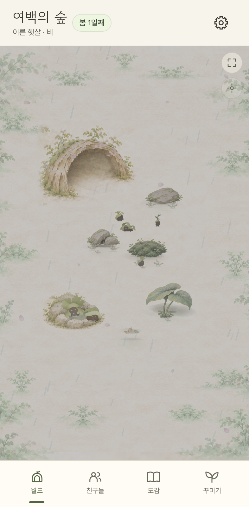
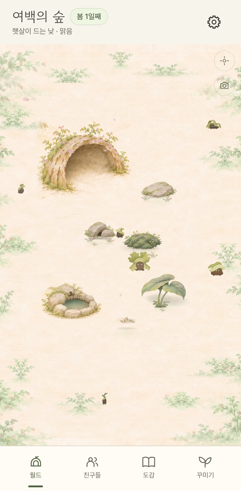
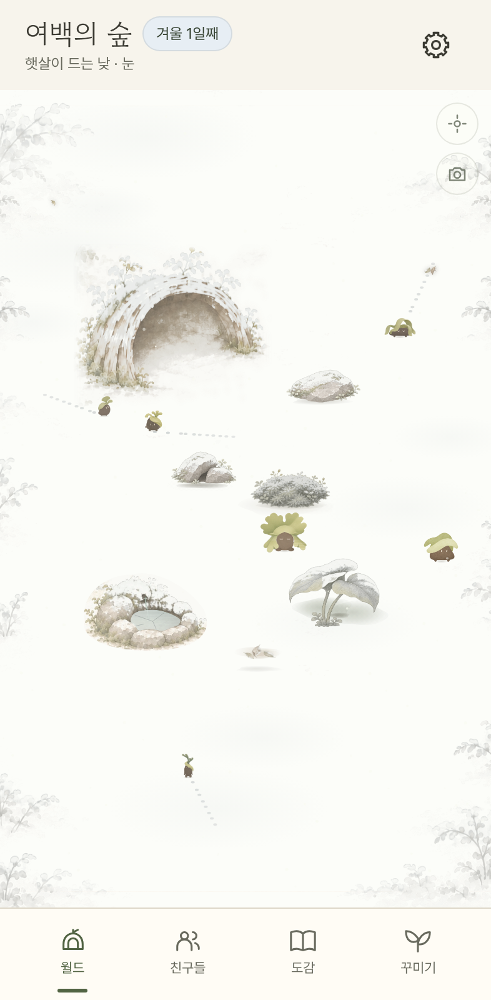
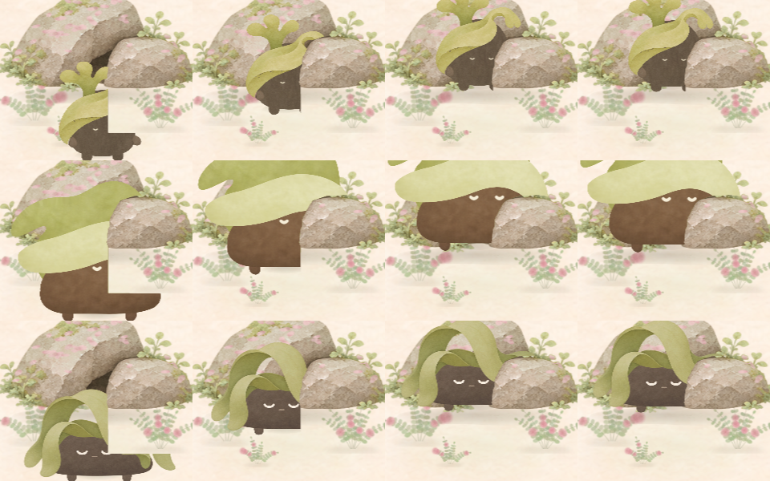
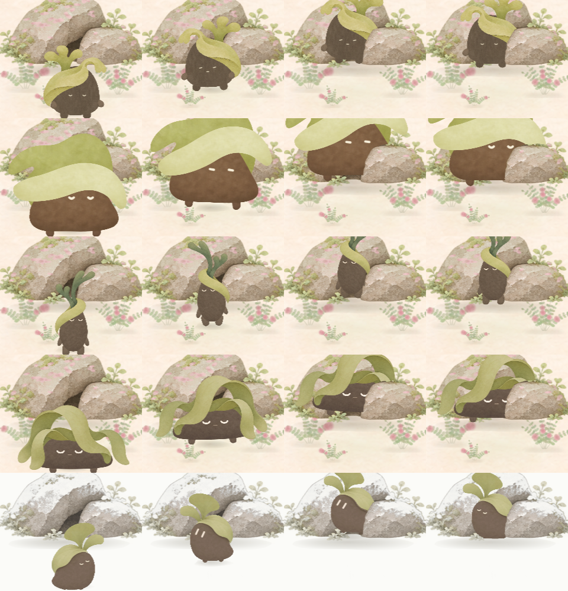

# 여백의 숲 SRS v2.32 · 화면 정리, 밤 잠·비 피하기, 겨울 눈, 빈 땅 산책, 바위틈 들어가기

2026-11-20 · APK 0.8.2 ~ 0.8.6 / versionCode 60 ~ 64 · 규칙 식별자 `SRS-2.19-objects`. 저장 스키마 버전은 그대로 둔다.

APK 0.8.2~0.8.6에서 바뀐 화면·친구 행동·날씨·연출 규칙을 정리했다. 사계절과 계절 풍경은 `Forest-Seasons-SRS-v2.31.md`, 짐꾼개미 군락은 `Forest-Ant-Colonies-SRS-v2.30.md`, 넓은 숲은 `Forest-Map-Expansion-SRS-v2.29.md`, 쉬는 자리·모션은 `Forest-World-Motion-SRS-v2.27.md`를 따른다. 이 문서는 통합 SRS(v2.22 PDF)에 더하는 변경안이다.

## L32-01 원칙

- 상태 엔진은 1초 고정 단계이고, 렌더는 상태와 난수를 바꾸지 않는다. 화면 정리(L32-02)·연출(L32-07)·바위틈 들어가기(L32-08)는 렌더 전용이다.
- 물·낙엽 보존식과 저장 호환성을 지킨다. 새 저장 값(`p.stroll`, `settings.showFrame`)이 없는 예전 저장도 그대로 불러온다.
- 고요하고 차분한 수묵화 힐링 게임이라는 방향을 지킨다. 안내는 필요할 때만 잠깐, 빈 땅은 여백으로 남긴다.

## L32-02 화면 정리 (0.8.2)

| 항목 | 규칙 |
|---|---|
| 조경 모드 | 머리의 '게임/조경' 버튼과 전환을 없앴다. 조경 모드로 저장된 기록은 불러올 때 게임 모드가 된다. 꾸미기 탭(배치)은 그대로다. 엔진의 조경 처리(`s.mode==='landscape'`)는 저장 호환을 위해 남긴다. |
| 보기 버튼 | 오른쪽 위 작은 반투명 아이콘 하나. 평소에는 '전체 보기'(숲 전체), 전체 보기 중에는 '기본 배율'(처음 화면 크기·정원 가운데). |
| 사진 | 카메라 아이콘. 지금 화면 구도(확대·축소·끌어 본 그대로)의 월드 캔버스만 PNG로 저장한다. 버튼·안내·카드는 들어가지 않고, 친구 선택 링도 찍는 순간 뺀다. 찍을 때 화면이 살짝 하얗게 번쩍인다. Android는 갤러리 `사진/여백의 숲`(MediaStore, 권한 없음, 실패하면 만든 항목을 지움), 브라우저는 파일 내려받기. |
| 계절 표시 | '여백의 숲' 제목 바로 옆. 글자는 늘 진한 먹색(밤 화면에서 밝은 글자가 연한 바탕에 묻히던 문제). |
| 안내 문구 | 늘 떠 있던 말풍선을 없앴다. 손님이 찾아올 때, 친구가 목마를 때, 비가 오기 시작할 때, 바위틈에 작은 이웃이 왔을 때만 월드 하단 가운데에 5초 떴다가 사라진다. 같은 안내는 상황이 바뀌기 전에 다시 뜨지 않는다. 손님 안내는 떠 있는 동안 누르면 만남 화면으로 간다. |
| 친구 수 | '6 / 5' 대신 '6명'(0.6.33부터 정원 인원 제한 없음). |
| 함께 지낼 예정 명단 | 친구들 화면에서 뺐다. 쉼터 확장 판단은 정원의 모든 친구를 다 자란 크기로 센다(예전 저장의 명단도 함께 센다). |

## L32-03 밤 잠·비 피하기 (0.8.3)

| 규칙 | 값 |
|---|---|
| 밤 | 게임 하루(1,200초)의 620~1,150초. 급한 필요(목마름·배고픔)가 없는 친구가 잠자리를 고른다. |
| 잠자리 | 쉼터에 자리가 있으면 쉼터(가중치 +40), 없으면 이끼·잎 그늘·바위틈·햇살 바위. 새벽이 되면 일어난다. 쉼터 카드 "포근한 쉼터 안에서 자고 있어요". |
| 비 피하기 | 비+눈 강수 0.25 이상이면 쉼터·잎 그늘·바위틈·햇살 바위로 피한다. 쉼터 카드 "쉼터 안에서 비를 피하고 있어요". |
| 종별 예외 | 비를 좋아하는 친구(종 특성 `rain` > 0: 리들리·엘리시·코로나·슈퍼범)는 보슬비는 맞고 큰비(0.6 이상)에만 피한다. 슈퍼범은 머리 둥지에 빗물을 모으므로 피하지 않는다. 엘레판과 엘레판 곁(0.3 안) 친구는 엘레판 잎 우산 아래에 있는다. |
| 꽉 찬 쉼터 | 잠·비 피하기·그냥 들르기로 왔는데 자리가 다 찼으면 8초 기다린 뒤 다른 자리로 간다(쉼터는 120초 동안 다시 고르지 않음). 지쳐서 왔거나 강풍을 피하는 친구는 이전처럼 기다린다. |
| 그냥 들르기 | 쉼터는 자유 방문 후보에 절반쯤만 들어간다. |
| 같은 자리, 새 이유 (0.8.5) | 이미 머물던 자리(예: 그냥 들른 쉼터)에서 큰비가 오면 자리는 그대로 두고 이유를 '비 피하기'로 바꾼다. |

**길을 못 찾고 멈추던 문제(0.8.3):** 친구가 지나갈 수 없는 자리 안(샘터 돌 테두리, 쉼터 벽 판정, 엘레판의 펼친 잎 둘레)에 서 있으면 출발점부터 막혀 "오브젝트로 갈 수 있는 길을 찾고 있어요"로 멈췄다(시뮬레이션 최대 850초). 이제 모든 장애물과 쉼터 벽 안에서 시작하면 밖으로 걸어 나오고, 한 번 나오면 다시 들어가지 않는다.

측정(친구 5명, 시드 4개 × 2게임시간): 쉼터 안 시간 하루 17% → 31%, 밤 18% → 53%(기본 쉼터 3자리라 5명 중 최대 60%). 멈춘 시간 2~3% → 0.04%, 가장 길게 멈춘 시간 850초 → 21초(`tools/shelter-sleep-review.cjs`, `tools/blocked-path-review.cjs`).

## L32-04 겨울 날씨 (0.8.4)

- 날씨는 120~240초마다 바뀌고, 같은 날씨는 두 번 연속까지만 나온다(흐림이 가장 길어도 약 8분). 앱을 연 동안에만 날씨가 바뀐다.
- 숲이 오래 마르면(촉촉한·온화한 숲 600초, 그 밖 900초) 한 번 내려 주는 비(AC219-04)는 계절을 따른다.
  - 계절 표의 눈 비율 0.5 이상(겨울)이면 눈을 내린다.
  - 비·눈이 없는 계절(마른 숲 겨울)에는 작동하지 않는다. 기다리던 차례가 그런 계절에 오면 취소하고 평소처럼 날씨를 고른다.
  - 눈이 온 것도 '물이 왔다'로 센다(비 + 눈 강수 0.35 이상 120초).
- 이전에는 늘 비를 내리고 눈은 세지 않아, 촉촉한 숲 겨울 시간의 14~20%, 마른 숲 겨울 11~13%가 비였다. 이제 겨울 비는 가을에서 이어진 처음 최대 265초만 남는다.
- 겨울 친구 몸 물(시드 3개): 촉촉한 숲 평균 46.2 → 45.1, 마른 숲 48.0 → 44.5(최저 24.8, 원래 결정대로 비·눈 없는 겨울).

## L32-05 빈 땅 산책 (0.8.5)

| 규칙 | 값 |
|---|---|
| 언제 | 급한 필요가 없고 밤·비가 아닐 때 자유 행동을 고르는 순간, 잎에 잎응애가 없으면 30%(`STROLL.chance`). 머리 정돈(25%, 잎 해충이 있으면 55%) 다음 구간이다. |
| 어디로 | 넓은 숲의 걸을 수 있는 땅 중, 지금 자리에서 0.25 이상 떨어진 곳. 여덟 번까지 뽑으며 앞의 여섯 번은 예전 정원(0~1) 바깥 둘레만 받는다. |
| 얼마나 | 걸어가서(최대 90초) 15~30초 둘러보고 다시 행동을 고른다. 세 번 막히거나 90초가 지나면 그만둔다. |
| 그만두기 | 목마름·배고픔·밤·비·위험이 생겨 다른 과제가 정해지면 바로 그만둔다. 쉼터 요청과 들어 올림이 먼저다. |
| 자원 | 쓰지도 만들지도 않는다. |
| 카드 | "숲 가장자리로 산책 가고 있어요" / "숲 가장자리를 천천히 둘러보고 있어요" |
| 저장 | `p.stroll`({x, y, since, deadline, linger, arrivedAt?, stalled?}). 검증한다(좌표 숫자, 둘러보기 60초 이하). |

같이 고친 것: 자유 행동이 끝난 순간에는 끝난 과제가 남아 있어 머리 정돈이 거의 고려되지 않았다. 이제 끝난 자유 행동 다음에도 머리 정돈·산책을 고를 수 있다.

측정(친구 5명, 시드 4개 × 2게임시간): 바깥 땅(0~1 밖)에 있는 시간 평균 1.4% → 5.9%, 낮 1.8% → 10.6%. 출발한 산책의 대부분이 도착해 둘러보고 돌아온다(시드 2: 67번 중 62번). 몸 물 30 미만 시간 0%. 개미 군락이 한 해 안에 오는 시드 8개 중 6개 → 8개.

## L32-06 곤충이 나타나는 곳 (0.8.5 확인)

- 작은 이웃의 출현 규칙에는 정원 범위 제한이 없다. 숙주를 따라 나타난다: 낙엽 더미·낙엽 자리(뿌리날파리·흙지기·톡토기), 친구 잎(잎응애·솜깍지·점박이·잎지기), 리들리 곁(짐꾼개미), 바위·바위틈(쏙쏙이·돌돌이).
- 낙엽(6×5칸)은 0.7.0부터 숲 전체에 떨어진다. 친구 잎에 붙는 이웃은 친구가 가운데에만 있어 바깥에 거의 없었는데, 산책으로 함께 늘었다.
- 측정(친구 5명, 온화한 숲, 시드 3개 × 3게임시간): 곤충이 바깥 땅에 있는 비율 22.1% → 24.8%. 솜깍지 바깥 10 → 52, 점박이 0 → 16, 잎지기 0 → 6(30초마다 센 횟수).

## L32-07 숲 전체의 눈·바람 잎·안개, 고사리 액자 (0.8.5)

- 눈송이·바람에 날리는 잎·안개를 넓은 숲 전체(세계 범위)에 그린다. 개수는 넓이(2.25배)에 비례해 밀도가 같다(예산 120 × 넓이). 안개 띠도 넓이에 맞춰 늘린다.
- 가을에 천천히 떨어지는 잎도 넓이에 비례한다(4장 → 9장). 봄 꽃잎과 비바람 잎은 원래 화면 전체에 그린다.
- 고사리 액자: 설정 '표시와 움직임'의 '고사리 액자' 스위치. 기본은 켜짐이고, 값이 없는 예전 저장도 켜진 채로 불러온다(`settings.showFrame`, 값이 있으면 참/거짓만 받는다).

## L32-08 바위틈에 걸어 들어가기 (0.8.6)

0.6.35 '틈에 쏙 들어가기' 연출의 결함을 바로잡았다(렌더 전용).

| 이전 | 이후 |
|---|---|
| 쉬는 자리(돌 앞)에서 틈 입구까지(약 0.04)를 쉬는 자세 그대로 0.6초에 미끄러졌다. 쉬기를 마치면 한 프레임에 원래 자리로 튀어나왔다. | 쉬러 갈 때의 느린 걸음(`GU × 0.6`)으로 걸어 들어가고 걸어 나온다(약 1.7초, 걷기 모션, 틈 쪽을 바라봄). 동작 줄이기에서는 바로 자리를 바꾼다. |
| 돌 아래 바닥 띠(타일 x 280~472, y 350~440) 잘라 내기와 작은 돌 덮기가 들어가기 시작부터 적용돼, 돌 앞에 선 친구가 직사각형으로 잘렸다. 모든 종 공통. | 작은 돌은 친구 발이 돌 아랫단(타일 y 352)보다 뒤일 때만 덮는다. 바닥 띠 잘라 내기는 틈에 다 앉았을 때만 한다. |

## L32-09 수락 기준 ↔ 테스트

| AC | 내용 | 테스트 |
|---|---|---|
| L32-AC01 | 보기 버튼 하나로 전체 보기↔기본 배율, 사진이 상태·선택을 바꾸지 않음, 조경 버튼·명단 칸·'/ 5' 없음 | `tools/ui-smoke.mjs` |
| L32-AC02 | 밤에 쉼터에서 자고 새벽에 일어남 | `shelter-sleep` SL-01 |
| L32-AC03 | 꽉 찬 쉼터면 다른 곳에서 잠(입구에서 밤새 기다리지 않음) | `shelter-sleep` SL-02 |
| L32-AC04 | 비 피하기와 종별 예외·엘레판 우산, 큰비 때 같은 자리 이유 바꾸기 | `shelter-sleep` SL-03 |
| L32-AC05 | 샘터·쉼터 벽 안에서 걸어 나옴 | `shelter-sleep` SL-04 |
| L32-AC06 | 겨울 비 내려 주기는 눈, 마른 숲 겨울은 작동 안 함, 눈도 물로 셈 | `seasons` SE-0.8.4 |
| L32-AC07 | 산책 출발·도착·끝, 카드 문구, 저장 왕복 | `stroll` ST-01 |
| L32-AC08 | 밤·목마름이면 산책을 그만둠, 잘못된 산책 기록 거부 | `stroll` ST-02 |
| L32-AC09 | 눈이 넓이만큼 | `stroll` ST-03 |
| L32-AC10 | 고사리 액자 설정 | `stroll` ST-04 |
| L32-AC11 | 바위틈에 걸어 들어가고(0.7초에는 가는 중) 걸어 나옴 | `rock-rider` |
| L32-AC12 | 잎 해충이 있으면 정돈이 늘고 그늘·물가를 고름(끝난 자유 행동 뒤 정돈 포함) | `neighbours-plants` |

검증 기록: 0.8.6 기준 자동 326/326, DOM UI PASS. 각 버전의 측정·화면은 `docs/qa-0.8.2` ~ `docs/qa-0.8.6`. Android 실기기는 모든 항목에서 미검증이다.

## L32-10 남은 일

- 산책 중 전용 동작(둘러보기·냄새 맡기·앉아 쉬기) — 0.8.7 예정.
- 첫 지역 해금(동쪽 호수) 기획 — 다음 문서.
- 두리 전용 그림, 계절 배경음 실제 청취 피드백, Android 실기기(갤러리 저장·성능·APK 용량).
