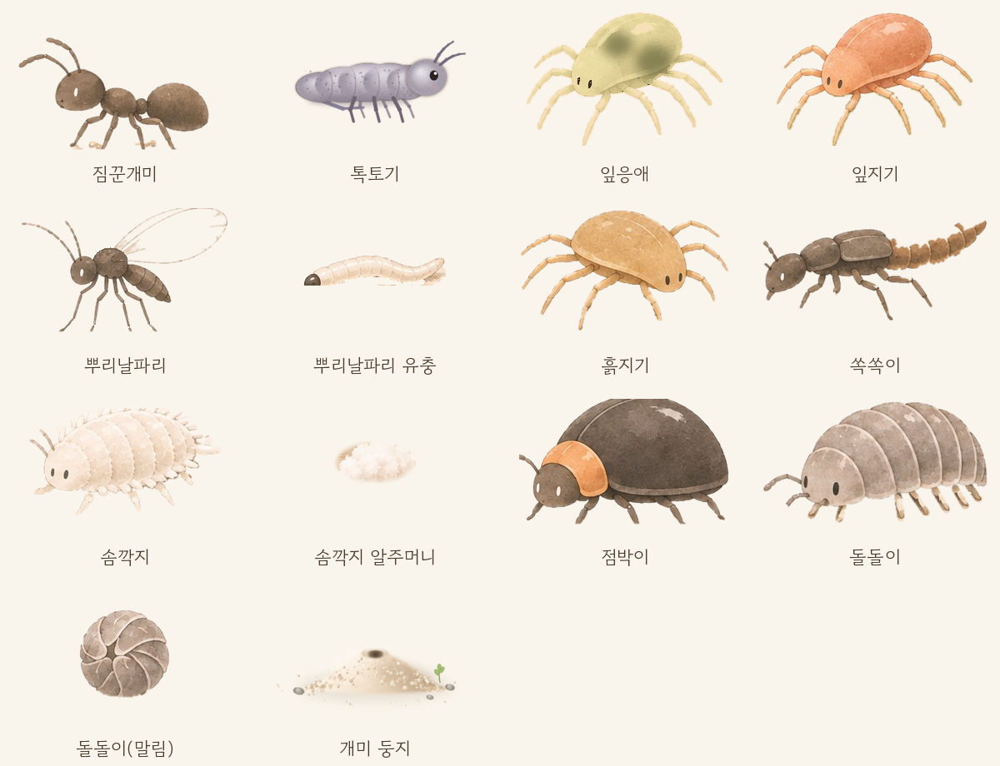

# 여백의 숲 SRS v2.27 · 작은 이웃 생태계

2026-11-18. APK 0.6.34 기준이며, 실제로 구현된 규칙을 정리했다. v2.25(APK 0.6.28)를 대체한다. 대상은 다음과 같다.
- v2.24 생태계 2단계: 패치 6a(짐꾼개미·톡토기), 6b(잎응애·잎지기), 6c(뿌리날파리·흙지기·솜깍지·점박이)
- 0.6.28 추가: 쏙쏙이, 돌돌이 그림·분해 보조, 식물(친구)과의 관계
- **v2.27 변경(0.6.32~0.6.34):**
  - 감로 식과 개미 지키기 기준을 낮췄다(NB-03·NB-04).
  - 점박이 유충이 가까운 친구의 솜깍지로 옮겨 간다(NB-04).
  - 잎응애가 붙은 친구가 부르르 떤다(NB-05).
  - 도감에 이웃 그림·실루엣·만난 수를 보여 준다(NB-06).

이 문서는 통합 명세 v2.22의 다음 장을 대체·보완한다.
- S05.05 해충별 발생과 회복
- S05.06 우호 생물과 조건부 관계
- S05.07 복합 상황
- S05.09 해충 전이와 천적의 먹이 계약
- D04.20~25 작은 이웃 형태 시안·표시

낙엽 구역 규칙은 `Forest-Ecosystem-SRS-v2.24-L1.md`를 따른다. 모든 시간과 수치는 게임 설계값이며 실제 방제 처방이 아니다.

## NB-00 원칙

| ID | 내용 |
|---|---|
| NB-00a | 작은 이웃은 친구(식물 캐릭터)가 아니며 5명 편성 자리를 쓰지 않는다. 상위 메뉴는 "작은 이웃"으로 통일하고, 도감에 분류를 적는다. 응애류를 곤충으로 쓰지 않는다. |
| NB-00b | 생태 계산은 1초 고정 단계에서 독립 난수 `rng.creatures`로 한다. 렌더는 상태·난수를 바꾸지 않는다. 동작 줄이기에서는 움직임을 멈춘다. |
| NB-00c | 이름만으로 좋은 생물·나쁜 생물을 단정하지 않는다(NAM-03). 화면에는 지금의 관계만 쓴다(예: "잎응애를 찾아 먹는 중", "젖은 낙엽 곁이라 유충이 뿌리를 귀찮게 해요"). 밀도 수치는 보여 주지 않는다. |
| NB-00d | 저장: `objects.creatures`(무리·준비 시간·대기·관찰 기록 `seen`)에 둔다. 저장 스키마 버전은 그대로이고, 옛 저장은 처음 불러올 때 빈 기록으로 시작한다. 무리 수·종류·밀도 범위는 저장 검증에서 확인한다. |
| NB-00e | 자원은 새로 만들지 않는다. 개미가 옮기는 잎과 흙지기가 먹는 남은 거름 U는 낙엽 보존식(저장 잎 + 흡수 + 흙 유출 = 시작 + 유입) 안에서만 움직인다. |

## NB-01 출현 공통 규칙

| ID | 규칙 |
|---|---|
| NB-01a | 게임 시작 600초 동안은 아무도 오지 않는다. 이후 180초마다 판정한다. |
| NB-01b | 도움 이웃(짐꾼개미·톡토기)과 해충(잎응애·뿌리날파리·솜깍지)은 각각 600초에 새 무리 하나만 받는다(0.6.27부터 두 가족 분리). |
| NB-01c | 무리는 최대 8이다. 같은 판정에서 두 가족이 동시에 와도 8을 넘지 않는다. 활동하는 해충 종류는 최대 2가지다. |
| NB-01d | 후보가 되려면 조건이 120초 이어져야 한다. 단, 잎응애·솜깍지는 "자리 시간"을 쌓는다. 조건이 맞는 동안 쌓이고 아닐 때 10분에 걸쳐 줄며, 120초 이상이면 후보다. |
| NB-01e | 천적(잎지기·흙지기·쏙쏙이·점박이)은 ECO-07을 따른다. 먹이와 서식 조건이 120초 이어지면 60초마다 30%로 판정하고, 300초가 되면 반드시 온다. 공통 600초 간격은 쓰지 않는다. |
| NB-01e2 | 모든 무리는 조건이나 먹이가 120초 동안 없으면 떠난다. 떠남은 실패로 표시하지 않는다. |
| NB-01f | 한 친구가 해충에게 받는 부담(잎 손상 + 뿌리 부담 + 영양 감소)은 합쳐서 분당 2 이하다(ECO-05). |
| NB-01g | 해충이 회복되면 대기가 생긴다. 밀도가 5 미만인 상태가 60초 이어지면 회복으로 보고 무리를 지운다. 그 친구나 그 자리에는 300초 동안 같은 해충이 다시 오지 않는다. |

## NB-02 환경 판정

- **잎 국소 기후(친구마다):**
  - 맑은 날 그늘 밖이면 습도 −10이고, 그중 뜨거운 햇살 바위 위면 추가로 −25, 온도 +6이다.
  - 목마르면(몸 물 35 미만) −10, 물·이끼에서 멀면 −5다.
  - 샘터·이끼 가까이나 쉼터 안이면 +10이다.
  - 그늘은 잎 그늘 식물(0.145 안), 또는 **엘레판이 펼친 잎 아래**다.
  - 비·안개·눈일 때는 마르지 않는다.
- **낙엽 흙:** 더미와 기존 낙엽 자리의 촉촉함 M·고인 물 W는 낙엽 자리 흙의 값을 쓴다(0.6.25).
- **잎 사이 자리:** 잎 그늘 안이거나 다른 친구와 0.08 안에서 잎이 닿는 곳이다.

## NB-03 종별 규칙

| 이웃 (참고 생물 · 분류) | 오는 조건 | 하는 일·수치 | 줄거나 떠나는 조건 |
|---|---|---|---|
| **짐꾼개미** (개미 · 곤충) | 활동 중인 리들리(물 35·체력 40 이상), 낱잎 1장 이상, 바람 60 미만이 120초 → 20%. 리들리 곁에 흙 돔 둥지를 짓는다. | 90초마다 더미 없는 구역의 실제 낱잎 1장을 이웃 구역 더미·잎 모인 곳으로 옮긴다. 둥지 → 잎 → 목적지를 걷는다(최소 25초). | 120초 부적합이면 떠나며, 들고 있던 잎은 원래 자리로 돌려놓는다. |
| **톡토기** (Collembola · 톡토기류) | 낙엽 3장 이상, 생긴 지 60초, 촉촉함 35~75, 고인 물 1 이하, 기온 40~75인 더미가 120초 → 30%. 엘리시가 0.2 안이면 40%. 최대 2무리. | 그 더미의 분해만 ×1.25(놀이 보정과 곱해 최대 3.75). | 120초 부적합 |
| **돌돌이** (Armadillidium vulgare · 육상 등각류) | 이끼–바위틈 0.32 안, 이끼 촉촉함 40 이상, 바위틈 빛 45 이하·고인 물 5 미만, 바람 60 미만이 120초. 첫 방문은 보장하고, 이후 30%(엘리시 잎틈 45%), 두 번 놓치면 보장. | 최대 180초 쉰다. **0.6.28:** 머무는 동안 바위틈 0.25 안 낙엽 자리 분해 ×1.1(분해자). 친구가 0.08 안에 오거나 바람 60 이상이면 공처럼 말린다(표현). | 30초 부적합 또는 180초 → 돌아가고 600초 대기 |
| **잎응애** P02 (Tetranychus · 진드기류) | 잎 온도 65 이상·습도 35 이하의 자리 시간 120 → 20%. 친구당 하나. | 처음 밀도 12. 마른 잎 +4/분, 습도 35~55에서 정지, 촉촉한 잎 −6/분. 잎 정돈·쉼터 −4/분(쉼터에서는 늘지 않음). 잎 손상 2×밀도/100 per 분. | 회복(NB-01g) |
| **잎지기** (Phytoseiulus persimilis · 진드기류) | 잎응애 8 이상 + 잎 습도 45~80 (ECO-07). | 남은 잎응애만 분당 최대 8 먹는다. | 먹이·서식 없음 120초 |
| **뿌리날파리** P01 (Bradysia · 곤충) | 낙엽 흙 촉촉함 70 이상, 낙엽·거름 4 이상, 기온 45~80, 눈 아님이 120초 → 20%. 최대 2곳. | 성충 12로 온다. 120초 뒤 알 +4/분(성충 4 이상이면 최대 속도). 알은 90초에 걸쳐 유충, 유충은 180초에 걸쳐 성충이 된다. 성충 수명은 약 600초다. 합계 100 이하. 그 자리 0.12 안 친구에게 뿌리 부담 2×유충/100 per 분(유충만). | 흙 촉촉함 50~70 정지, 50 미만·눈 −6/분, 회복(NB-01g) |
| **흙지기** (Stratiolaelaps scimitus · 진드기류) | 유충·알 5 이상, 흙 촉촉함 35 이상·고인 물 10 미만 (ECO-07). | 유충, 그다음 알을 분당 최대 8 먹는다. 먹이가 없으면 남은 거름 U를 분당 1 먹으며(흙 원장으로) 머문다. 잎응애는 먹지 않는다. | 먹이·U 없음 120초 |
| **쏙쏙이** (Dalotia coriaria · 반날개 곤충) **0.6.28** | 유충·알 5 이상, 흙 촉촉함 35 이상·고인 물 10 미만, **바위틈이나 햇살 바위 은신처가 0.3 안** (ECO-07). 최대 2. | 유충, 그다음 알을 분당 최대 8 먹는다. 바위 뒤로 숨었다 나온다(표현). 대체 먹이는 없다(ECO-12). | 먹이 없음 120초 |
| **솜깍지** P03 (깍지벌레 · 곤충) | 기온 50~80·잎 사이 자리·쉼터 밖의 자리 시간 120 → 20%. 친구당 하나. | 처음 12. 기온 50~80이고 젖지 않으면 +4/분, 비·안개·눈에는 정지, 그 밖의 기온 −6/분. 정돈·쉼터 −4/분. 영양 부담 2×밀도/100 per 분. 감로 밀도/100×8 − 0.6 per 분(상한 100, **v2.27**: 이전 ×4 − 2). 20 이상이면 알주머니. | 회복(NB-01g) |
| **점박이** (Cryptolaemus montrouzieri · 곤충) | 솜깍지 20 이상(알주머니) + 친구가 쉼터 밖 (ECO-07). | 성충은 120초 살피기만 하고, 그 뒤 유충이 분당 최대 8 먹는다. 개미가 감로를 지키면 0.5배. 솜깍지를 다 먹으면 가까운 친구로 옮겨 간다(NB-04, **v2.27**). | 옮겨 갈 친구도 없이 먹이 없음 120초 |

## NB-04 먹이 관계와 조건부 관계 (ECO-08·12, X04)

| 먹는 쪽 | 먹이 | 한 자리 상한 |
|---|---|---|
| 잎지기 | 잎응애 | 8/분 |
| 흙지기 | 뿌리날파리 유충 → 알 (대체: 남은 거름 U 1/분) | 흙지기 + 쏙쏙이 합계 12/분 |
| 쏙쏙이 | 뿌리날파리 유충 → 알 (대체 없음) | 위와 같음 |
| 점박이 | 솜깍지 | 8/분 (개미가 지키면 4/분) |

- 짐꾼개미는 감로 **10** 이상이 30초 이어지면 솜깍지 곁을 지키며 운반을 멈춘다. 감로 **5** 미만이 60초 이어지면 다시 나른다(X04, AC-10). **v2.27**: 이전 기준은 20/10이었다.
  - 이유: 이전 식에서는 솜깍지 밀도가 50을 넘어야 감로가 쌓였는데, 실제 게임의 밀도는 최대 48이었다. 그래서 개미가 지키는 장면이 나오지 않았다.
  - 개미는 솜깍지를 쫓아내지 않는다. 감로를 얻으려고 솜깍지를 지키며, 그동안 점박이가 덜 먹는다(0.5배).
- **점박이 옮겨 가기(v2.27, 사용자 요청 "근처 케릭터 머리에 솜깍지가 남아 있으면 그쪽으로 넘어가서 먹는"):**
  - 점박이 유충이 지금 친구의 솜깍지를 다 먹으면(밀도 1 미만), 0.2 안의 친구 중 가장 가까운 친구에게 옮겨 간다.
  - 옮겨 갈 친구는 솜깍지가 남아 있고(밀도 `MEALY.GONE` 이상), 다른 점박이가 없고, 쉼터 안·목부작이 아니어야 한다. 거리가 같으면 ID 순서로 고른다.
  - 옮길 때 "점박이 유충이 (이름)에게서 (이름)의 잎으로 옮겨 갔어요." 기록을 남기고, 먹이 없는 시간을 0으로 되돌린다. 옮긴 횟수는 `hops`에 센다.
  - 옮겨 갈 친구가 없을 때만 기존대로 120초 뒤 떠난다.
  - 친구당 점박이 하나 규칙(저장 검증)은 그대로다.
- 흙지기·쏙쏙이는 잎 해충을 맡지 않는다(AC-08).
- 먹은 만큼만 차감하고 남은 먹이보다 많이 먹지 않는다. 먹이를 새로 만들지 않는다.

## NB-05 식물(친구)과의 관계

| 친구 | 작은 이웃과의 관계 |
|---|---|
| 리들리 | 짐꾼개미가 리들리 곁에 둥지를 짓는다(저수엽·개미 관계, SPC-01). |
| 엘리시 | 가까운 더미에 톡토기가 더 잘 찾아온다(30→40%). 잎틈 정원이 있으면 돌돌이 재방문이 30→45%다. |
| 엘레판 | **0.6.28:** 펼친 잎 아래 친구의 잎은 잎 그늘 식물 아래처럼 마르지 않는다(습도 +10 상당). 잎응애가 덜 생긴다. 잎을 접으면 효과가 없다. |
| 모든 친구 | **0.6.28 친구 쪽 반응:** 자기 잎에 잎응애나 솜깍지가 있으면, 자유 행동에서 잎 정돈 확률이 25%에서 55%가 된다. 잎응애가 있으면 그늘·샘터를 먼저 고른다(잎이 촉촉해지면 줄어든다). 뿌리날파리 유충이 사는 낙엽에서는 놀지 않고, 영양을 먹을 때도 그곳을 마지막으로 고른다. 기존 난수 추첨을 그대로 써서 재현 가능하다. |
| 모든 친구 | **v2.27 잎응애 떨기:** 잎응애가 잎에 붙은(밀도 5 이상) 친구는 7초마다 1.35초 동안 웅크렸다 부르르 떨고 먼지 티를 털어 낸다. 6종 모두 같은 공통 모션이며, 하던 동작 위에 겹친다. 친구마다 시점이 다르다(`seed`). 들려 있거나 쉬기·잠·이끼·착지 중에는 떨지 않고, 동작 줄이기에서는 멈춘다. 렌더 전용이다. 화면은 `Creatures.onLeaf`를 읽기만 하고 상태·난수를 바꾸지 않는다. 솜깍지(영양 부담)에는 떨지 않는다. |
| 모든 친구 | 해충 부담은 기존 회복 경로(쉼터·물·휴식, 잎 지침 30에서 회복 행동)로 돌아간다. 천적이 없어도 회복할 수 있다(AC-14, X05). |

## NB-06 그림과 움직임 (D04.20~25 반영)

- **출처:** v2.22 통합 PDF 249~253쪽 작은 이웃 형태 시트(1536×1024)에서 원본 픽셀을 그대로 쓴다.
  - 짐꾼개미·점박이·잎지기·뿌리날파리(성충·유충)·흙지기·쏙쏙이·솜깍지(+알주머니)·돌돌이(+말린 공)
  - 잎응애는 시트에서 잎과 색이 같아 잘라낼 수 없다. 같은 틀의 잎지기 그림을 시트 08 색으로 다시 칠했다.
  - 톡토기는 시트에 없어 시트 화풍으로 새로 그렸다.
- **누끼:** 흙은 줄로 자르지 않고 색(LAB 노란기)으로만 구분한다. 흙지기·솜깍지·돌돌이·쏙쏙이는 OpenCV GrabCut으로 땄다.
  - 종이·흙과 색이 같은 부위는 마스크를 손으로 짚고, 그 안에서 원본 픽셀을 쓴다. 솜깍지 등 돌기는 몸 윗선을 따라, 돌돌이 다리는 엉덩이에서 발끝까지 짚었다.
  - 원본 대 결과 비교는 `qa-0.6.27/runtime/cutout-fixes.png`에 있다.
- **리그:** `tools/rig-neighbours.py`가 그림을 몸통과 부위(다리·날개·더듬이)로 나눈다. 부위마다 아틀라스 칸과 회전축이 따로 있다.
  - 다리는 두 무리가 번갈아 딛는다. 뿌리날파리 날개는 빠르게 날갯짓한다. 더듬이는 흔들린다. 유충은 띠 물결로 꿈틀거린다.
  - 솜깍지 왁스 돌기는 움직이지 않는다. 진드기류는 더듬이가 없다.
- **크기:** 화면에서 작은 실루엣으로 둔다(잎 위 진드기 3~4dp, 개미·쏙쏙이 약 0.03 월드 폭). 캐릭터 크기로 키우지 않는다.
- **도감:** 10종 모두 이름·분류·하는 일을 보여 준다. 기록은 `objects.creatures.seen`이고 0.6.28부터 쌓인다.
  - **v2.27(0.6.32):** 만난 이웃은 게임 그림을 보여 준다. 못 만난 이웃은 옅은 그림자 실루엣과 회색 카드에 "아직 못 만났어요"로 보인다. 맨 위에 "만난 이웃 n / 10"을 보여 준다.
  - 이유: 글만 있는 카드라 만난 이웃과 못 만난 이웃의 차이가 작아 "도감이 채워지지 않는다"는 제보가 있었다. 기록 자체는 정상이었다.
  - 도감 그림은 확대 표현이라고 적는다.

## NB-07 v2.22·v2.24 초안 대비 변경

| 항목 | 초안 | 구현 | 이유 |
|---|---|---|---|
| 잎응애 출현 | 연속 120초 | 자리 시간 누적(10분 감쇠) | 햇살 바위에 머무는 시간이 15~40초라 기본 기후에서 생기지 않음 |
| 잎응애 감소 | 부적합 −6 | 습도 35~55 정지 구간 | 잎지기(45~80)가 준비하는 동안 먹이가 남도록(이슈 #15 역설) |
| 뿌리날파리 자리 | 친구 근권 R 70 | 젖은 낙엽 흙 | 친구의 뿌리 물 Q가 거의 0(최대 R 25) |
| 흙지기 서식 | 촉촉함 35~65 | 35 이상·고인 물 10 미만 | 낙엽 흙이 쉽게 100이 됨 |
| 솜깍지 증가 | 잎 사이 자리 | 붙는 자리 / 늘어나는 조건 분리 | 잎 사이 자리가 드물어 밀도가 늘지 않음 |
| 출현 간격 | 전역 600초 하나 | 도움 이웃·해충 따로 | 해충이 도움 이웃의 출현 자리를 차지함 |
| 천적 간격 | 공통 600초 | ECO-07만 | 먹이가 사라지기 전에 오도록 |
| 돌돌이 | 쉬러만 옴 | 근처 낙엽 분해 ×1.1 | 실제 분해자 역할 |

## NB-08 수용 기준과 자동 검사

| 기준 | 검사 파일 |
|---|---|
| 600초 보호, 180초 판정, 가족별 600초 간격, 8무리, 해충 2종 | `creatures.test.cjs` |
| 개미 운반 보존식, 톡토기 ×1.25·상한, 120초 이탈, 운반 중 이탈 시 잎 반환, 저장 검증 | `creatures.test.cjs` |
| 잎 국소 기후, 촉촉한 잎 출현 없음(AC-05), 잎응애 밀도·잎 부담, 회복·300초, 잎지기 120~300초·8/분, 먹이 없으면 이탈(AC-11), 소장 중 정지 | `leaf-mites.test.cjs` |
| 뿌리날파리 조건·단계 이동·상한, 유충만·그 자리만 부담(AC-06/07), 흙지기 도착·포식·U 보존·잎응애 제외(AC-08), 솜깍지 감로·부담, 개미 지키기·점박이 0.5배(AC-10), 점박이 알주머니·살피기, 부담 합계 2/분 | `soil-and-mealy.test.cjs` |
| 쏙쏙이 은신처·도착, 한 자리 합계 12/분, 대체 먹이 없음, 돌돌이 분해 ×1.1, 엘레판 그늘, 친구의 해충 반응, 도감 관찰 기록 | `neighbours-plants.test.cjs` |
| **v2.27** 감로 새 식(×8 − 0.6), 개미 지키기 10/5, 점박이가 가까운 친구로 옮겨 가고 먼 친구로는 가지 않음·먹이 없으면 이탈 | `soil-and-mealy.test.cjs` |
| **v2.27** 잎응애 떨기: 6종 모두 떨고, 7초 중 일부만, 잠잘 때는 떨지 않고, 렌더 옵션 불변 | `rig.test.cjs` |
| **v2.27** 도감 10항목·만난 1종만 채워짐·모든 항목 그림·"만난 이웃 1 / 10" | `tools/ui-smoke.mjs` |

## NB-09 검증 결과 (0.6.28, 실제 엔진, 8시드 × 3게임일)

숫자는 8시드 중 한 번이라도 나타난 시드 수다. 돌돌이 칸은 시드별 방문 수다. 낙엽 보존식 오차는 0이었고, 해충 종류는 2가지·무리는 8 이하를 지켰다.

| 기후 | 개미 | 톡토기 | 잎응애 | 잎지기 | 뿌리날파리 | 흙지기 | 쏙쏙이 | 솜깍지 | 점박이 | 돌돌이 방문 |
|---|---|---|---|---|---|---|---|---|---|---|
| C01 촉촉한 숲 | 8 | 0 | 0 | 0 | 7 | 6 | 3 | 8 | 5 | 1~4 |
| C02 온화한 숲 | 8 | 2 | 2 | 1 | 6 | 5 | 5 | 5 | 4 | 3~4 |
| C04 마른 숲 | 7 | 2 | 8 | 5 | 1 | 1 | 0 | 8 | 7 | 3~4 |

- 0.6.28 당시에는 감로가 솜깍지 밀도 50을 넘어야 쌓여서, 3일 동안 최대 0.5였고 개미가 감로를 지키는 장면이 나오지 않았다.
- **v2.27 재측정(APK 0.6.34, `tools/honeydew-review.cjs`, 친구 1명, 8시드 × 3게임일):**

| 기후 | 솜깍지가 생긴 시드 | 개미가 지킨 시드 | 최대 감로 |
|---|---|---|---|
| C01 촉촉한 숲 | 8 | 3 | 12.7 |
| C02 온화한 숲 | 6 | 3 | 53.7 |
| C04 마른 숲 | 6 | 5 | 58.8 |

  - 합계 11/24(0.6.33 측정은 12/24였고, 이후 점박이가 옮겨 다니며 솜깍지를 더 먹는다).
- 톡토기는 3일에 기회가 0~1번이라 시드마다 다르다. 0.6.25 측정은 4/8이었다.
- 기본 기후에서 잎응애는 7게임일에 4/8 나타났다(0.6.26 측정).
- Android 실기기·WebView·성능은 검증하지 않았다. 렌더는 scene.js와 native Canvas로만 확인했다.

## NB-10 남은 일

- 잎 해충 접촉 전이(ECO-13), 뿌리날파리 성충의 공중 전이
- 알·미성숙 단계 원화(잎응애·뿌리날파리·솜깍지), 점박이 유충 원화, 돌돌이가 말려 가는 중간 동작
- 감로 밸런스는 v2.27에서 조정했다. 장기(7게임일 이상)와 친구가 여럿일 때의 개미 지키기 비율은 아직 재지 않았다.
