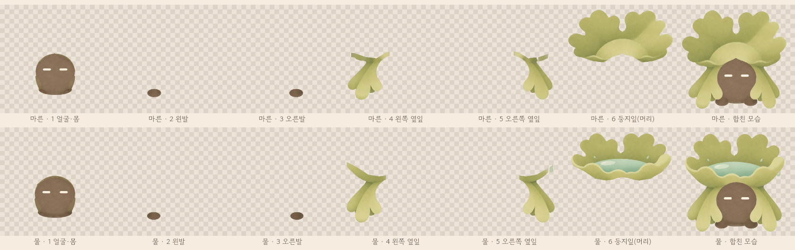
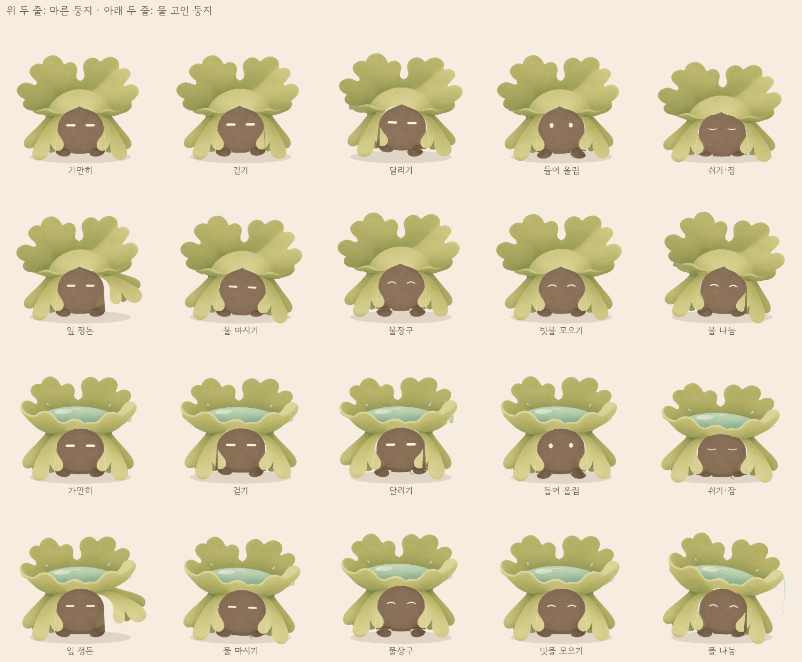

# 여백의 숲 SRS v2.26 · 슈퍼범 (Platycerium superbum)

2026-11-18 · APK 0.6.29 / versionCode 46 · 규칙 식별자 `SRS-2.19-objects`, 저장 스키마 버전은 그대로 둔다.

새 친구 **슈퍼범**을 숲에 들인다. 둥지잎에 빗물을 모았다가 목마른 친구에게 나눠 준다. 이 문서는 통합 SRS(v2.22 PDF)에 더하는 변경안이다.

## SB-01 원칙

- 슈퍼범은 친구(캐릭터)다. 친구 기록 50명 제한에 함께 든다(0.6.33부터 정원 5명 제한은 없다).
- 물 나눔(A04)은 처음에 봉봉(현 엘리시)의 능력이었다. 이 능력을 슈퍼범으로 옮긴다.
  - 엘리시는 더 이상 물을 모으지도 나누지도 않는다(0.6.14 결정 유지).
  - 저장된 엘리시의 `V`는 그대로 둔다.
  - 엘리시가 주던 옛 A04 기록은 계속 '은퇴(retired)'로 끝난다.
- 물은 새로 만들지 않는다. 슈퍼범이 모으는 물은 실제로 둥지잎 위에 내린 비이고, 강수 원장(`ledger.rain`)에 한 번만 기록된다. 나눌 때는 슈퍼범의 `V`에서 빠진 만큼만 친구의 몸 물 `B`로 간다.
- 렌더링은 상태와 난수를 바꾸지 않는다.

## SB-02 그림과 레이어

- **원화:** 사용자가 승인한 회종안(마른 둥지·물 고인 둥지 두 그림)이다. 원본 픽셀을 그대로 쓰고, 다시 그린 부분은 없다.
  - 누끼(`tools/cut-superbum.py`): 종이색과의 거리로 투명도를 정하고, 가장자리의 종이색을 걷어낸다. 크림색 눈은 몸에 둘러싸인 구멍이라 그대로 남긴다.
  - 레이어 분리: `tools/rig-superbum.py`.
- **레이어 순서(아래 → 위), 상태마다 한 벌씩:**
  1. 얼굴·몸: 둥근 얼굴이다. 옆잎이 덮는 볼 아래쪽은 더 넓게 이어 두어서, 잎이 흔들려도 틈이 보이지 않는다.
  2. 왼발·오른발: 몸 아래 가장자리 앞에 붙어 있다.
  3. 왼쪽·오른쪽 옆잎: 볼 위를 덮는다.
  4. 머리 잎(둥지잎): 가장 위에 그린다.
- **가려진 부분 채우기:** 같은 부위의 원본 픽셀에서만 채운다. 몸 아래 바닥 그림자 띠는 잎에서 뺀다.
- **물 상태:** 둥지 물 `V/40`이 0.12 이상이면 '물 고인 둥지' 그림으로 바뀌기 시작해 0.3에서 완전히 바뀐다(그 사이는 두 그림을 겹쳐 서서히 바꾼다).
  - 물이 있을 때는 수면이 반짝이고, 달리거나 들릴 때는 테두리에서 물방울이 떨어진다.
  - 물이 있을 때는 머리 잎을 평평하게 유지하며 조심조심 걷는다(걸음이 느리고 덜 들썩인다).
- **크기:** 리들리의 1.7배다. 엘레판(1.5배)보다 크다. 충돌 지름·선택 범위·이끼 가림 폭에도 1.7배를 쓴다.
- **초상화:** 게임 레이어로 구운 `superbum-portrait.png`(`tools/bake-superbum-portrait.cjs`).

## SB-03 모션

| 모션 | 움직임 |
|---|---|
| 가만히 | 천천히 숨 쉬며 들썩인다. 옆잎과 머리 잎이 살짝 흔들리고, 가끔 눈을 깜박인다. |
| 걷기 / 천천히 / 서두르기 | 두 발이 번갈아 들리며 앞으로 내딛는다. 몸이 걸음마다 들썩이고, 옆잎 아래쪽이 걸음 반대로 흔들린다. |
| 달리기 | 걷기보다 크고 빠르다. 물이 있으면 물방울이 튄다. |
| 들어 올림 | 발이 대롱거리고 옆잎이 팔랑인다. 놀란 눈을 하고, 물이 있으면 물이 흘러내린다. |
| 쉬기·잠·이끼 | 몸이 낮아지고 머리 잎이 내려앉는다. 눈을 감는다. |
| 잎 정돈 | 오른쪽 옆잎을 들어 머리 잎을 매만진다. |
| 물 마시기 / 물장구 | 몸을 숙여 마신다. 물장구 때는 통통 튀며 옆잎을 흔든다. |
| 빗물 모으기 | 비를 실제로 받는 동안 머리 잎을 활짝 펴고 하늘을 올려다본다. |
| 물 나눔 | 친구 쪽으로 머리 잎을 기울여 가는 물줄기를 붓는다. 둥지에 물이 있을 때만 물줄기가 보인다. |

- 옆잎은 볼에 붙은 윗부분이 고정되고 아래쪽만 휜다. 레이어를 통째로 돌리지 않는다.
- 동작 줄이기에서는 모든 흔들림이 멈춘다.
- 표정은 크림색 눈 모양으로만 나타낸다(감은 눈·웃는 눈·놀란 눈·집중·슬픔). 입은 그리지 않는다.

## SB-04 빗물 모으기

- 비가 오고, 슈퍼범이 활동 중이며 쉼터 지붕 아래·목부작·손에 들린 상태가 아니면 둥지잎에 비가 고인다.
- 1초에 받는 양은 `min(0.1, 12/60 × 강수 × 머리 면적 × 10)`이다.
  - 머리 면적은 `Environment.area`로, 슈퍼범은 2.89(=1.7²)배다.
- 둥지에는 최대 40까지 담긴다(`Social.NEST`). 출처는 `sources.rain`에 기록한다.
- 받은 양은 `ledger.rain`에 더한다. 그래서 물 보존식(총량 = 처음 + 비 + 눈 + … − 증발 − 유출 − 생리 소모)이 그대로 맞는다.

## SB-05 물 나눔 (A04)

- **시작:**
  - 둥지 물이 10을 넘는 건강한 슈퍼범이 있어야 한다. 건강은 몸 물 35·체력 40·영양 40 이상이고 해충 부담이 40 미만인 상태다.
  - 받는 쪽은 몸 물 35 미만인 활동 중인 친구다. 쉼터 안이 아니고, 갈 수 있는 길이 있어야 한다. 그런 친구가 여럿이면 가장 목마른 친구가 받는다.
- **진행:** 다가가기 → 받기 준비 → 건네기 → 반응. 건넬 때는 한 번에 최대 2씩, 받는 쪽의 몸 물이 65가 될 때까지 준다. 한 번 나눌 때 최대 5단계, 합계 10까지다. 슈퍼범의 둥지 물은 10 아래로 내려가지 않는다.
- **끝:** 30초 안에 닿지 못하면 끝난다. 강풍이나 건강 이상이 생겨도 멈춘다.
- **기록:** 비에서 모은 물을 나누면 발견 기록 EC02에 "(이름)이 비에서 모은 물을 친구에게 나눠줬어요."가 남는다.
- **엔진 확인 (`superbum.test.cjs`, 12게임시간, 2시드):** 시드마다 10씩 두 번 나눴다. 보존식 오차는 1e-9 미만이었다.

## SB-06 쉬기와 쉼터

- 쉼터에서 차지하는 자리는 성장 단계 0~3에 따라 5/6/8/10이다. 엘레판은 4/5/6/8이다. 쉼터 확장 판단에 쓰는 성체 예상치도 10으로 잡는다.
- 쉼터 모양 판정에는 실제 렌더에서 구운 윤곽을 쓴다(`tools/bake-superbum-profile.cjs`). 폭이 넓어 다 자란 슈퍼범은 기본 쉼터(1단계)에 들어가지 못하고, 넓힌 쉼터(2단계 이상)에는 들어간다. 어린 슈퍼범은 기본 쉼터에 들어간다.
- 제자리 쉼은 몸이 커서 맞는 휴식 자리가 없을 때를 위한 규칙이다.
  - 체력이 40 아래로 내려가고, 사물 과제·쉼터 요청·쉼터 자리가 모두 없고, 바람이 60 미만이면 제자리에서 쉰다. 둥지잎을 접고 체력을 분당 1.5씩 75까지 회복한다.
  - 다른 필요(목마름 등)가 생기거나 바람이 60 이상이 되면 멈춘다.
  - 상태 표시는 "둥지잎을 접고 제자리에서 쉬어요"다.
  - 이 규칙이 없을 때 엔진 측정에서 슈퍼범의 체력은 평균 40이었고, 95%의 시간 동안 40 미만이었다. 이 규칙을 넣은 뒤에는 평균 66이었고, 40 미만인 시간이 없었다.

## SB-07 영입

- **조건:** 샘터 물이 30% 이상이고, 입구에서 샘터로 가는 길이 열려 있어야 한다. 바람·폭풍·쉼터 길 같은 공통 조건도 지켜야 한다. 친구들 화면에 조건 두 줄과 현재 값을 보여 준다.
- **방문 순서:** 처음 찾아오는 손님이 엘리시인 규칙(0.6.23)은 그대로다. 슈퍼범은 그 뒤 다른 손님과 같은 규칙으로 온다. 조건이 180초 이어지면 35%로 찾아오고, 세 번 놓치면 다음에는 반드시 온다.
- **첫 만남 단계:**
  1. 새 자리에 익숙해지기 30초
  2. 샘터 살피기
  3. 하늘 올려다보기(둥지잎 펼치기)
  4. 쉬기 20초
- 첫 만남 카드에는 샘터 소품을 그린다. 하늘을 볼 때는 빗물 모으기 모션을 쓴다.
- 함께 살기로 하면 `V` 0(빈 둥지)으로 시작한다.

## SB-08 AC와 테스트

| AC | 내용 | 테스트 |
|---|---|---|
| SB-AC01 | 종 목록·1.7배·쉼터 점유·레이어 12장(마른/물)·초상화·팔 없음 | `superbum.test.cjs` 1, `render.test.cjs` 종 분기 |
| SB-AC02 | 비에서만 모음, 1초 0.1·최대 40, 원장 보존, 목부작·맑은 날 0, 엘리시는 모으지 않음 | `superbum.test.cjs` 2 |
| SB-AC03 | 목마른 친구에게 나눔, 보존식, EC02 기록 | `superbum.test.cjs` 3 |
| SB-AC04 | 제자리 쉼으로 체력 회복, 6게임시간 동안 35 미만으로 떨어지지 않음 | `superbum.test.cjs` 4 |
| SB-AC05 | 어린 슈퍼범은 기본 쉼터, 성체는 넓힌 쉼터부터 | `superbum.test.cjs` 5 |
| SB-AC06 | 영입 조건·첫 만남 4단계·정착 | `superbum.test.cjs` 6, `update218` 종별 조건 |
| SB-AC07 | 렌더 순수성, 물 상태에 따른 그림 전환, 10가지 모션 | `superbum.test.cjs` 7 |

## SB-09 남은 일

- 기본 쉼터 안에 성체 슈퍼범을 위한 자리를 따로 둘지(지금은 넓힌 쉼터가 필요하고, 그 전에는 제자리 쉼).
- 첫 만남 카드에서 슈퍼범이 커서 화면을 많이 차지한다. 실제 화면에서 확인할 것.
- Android 실기기에서 성능 확인. 옆잎을 띠 단위로 휘게 그려서, 한 프레임에 친구 한 명당 drawImage를 약 80번 부른다.
