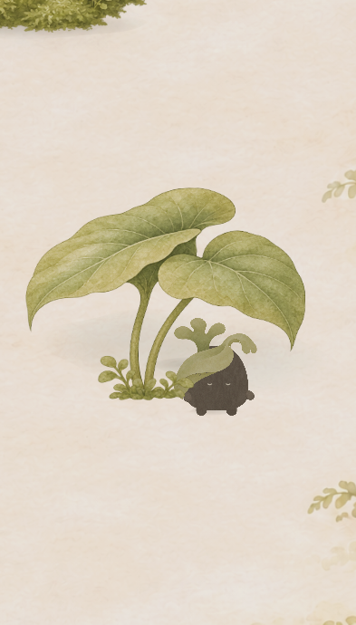
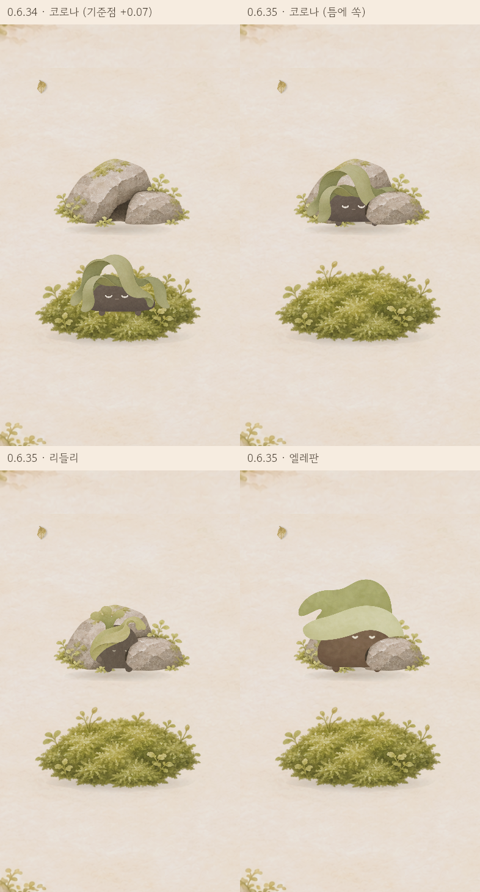
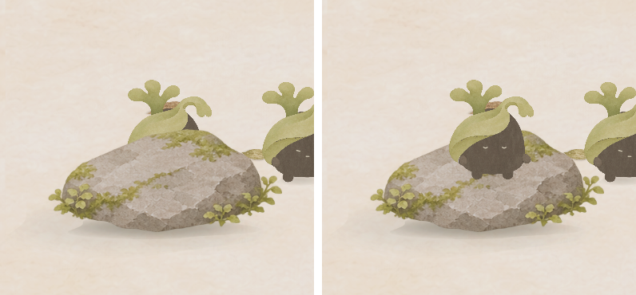
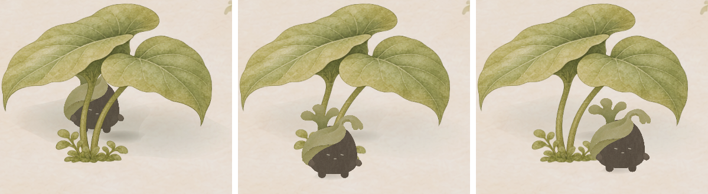
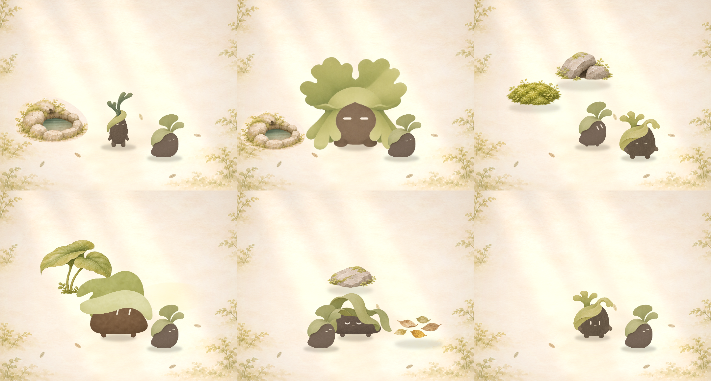
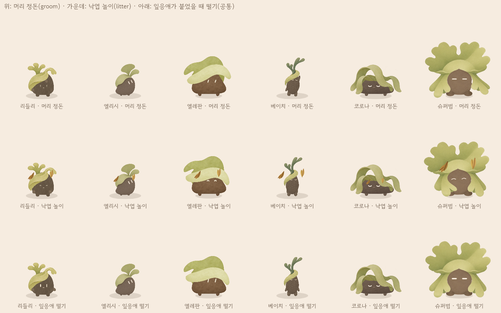

# 여백의 숲 SRS v2.27 · 쉬는 자리, 화면 겹침, 친구 수, 이름, 모션

2026-11-19 · APK 0.6.37 / versionCode 54 · 규칙 식별자 `SRS-2.19-objects`. 저장 스키마 버전은 그대로 둔다.

APK 0.6.30~0.6.37에서 바뀐 친구·월드 규칙과 모션을 정리했다. 작은 이웃 규칙(감로·개미·점박이 옮겨 가기·잎응애 떨기·도감)은 `Forest-SmallNeighbours-SRS-v2.27.md`에 있다. 슈퍼범은 `Forest-Superbum-SRS-v2.26.md`를 따른다. 이 문서는 통합 SRS(v2.22 PDF)에 더하는 변경안이다.

## W27-01 원칙

- 상태 엔진은 1초 고정 단계이고, 렌더는 상태와 난수를 바꾸지 않는다. 이 문서의 모션·겹침 변경은 모두 렌더 전용이다.
- 물·낙엽 보존식과 저장 호환성을 지킨다. 이름을 바꿀 때 내부 종 키와 별명은 바꾸지 않는다.

## W27-02 쉬는 자리 (0.6.30)

| 자리 | 규칙 |
|---|---|
| 잎 그늘 | 장애물은 줄기 밑동만이다(반지름 0.024×0.012, 기준점 −0.034/+0.004). 쉬는 자리는 줄기 오른쪽 잎 아래(+0.035, +0.02)다. 예전에는 식물 전체가 넓은 타원 장애물이라, 친구가 그 바깥 멀리에서 쉬었다. |
| 엘레판 잎 아래 | 친구를 처음 앉히는 자리를 잎 아래 깊은 자리(엘레판 기준 +0.075, +0.014)부터 고른다. 잎 높이 판정(`canFit`)은 그대로다. |
| 햇살 바위·바위틈 옆면 | 돌 발자국을 친구 몸 너비의 절반(지름 × 0.55)만큼 넓혀 판정한다. 바위 윗면에 오르내리는 길과, 돌 안에서 시작한 친구가 밖으로만 나가는 규칙은 그대로다. 엔진 측정(2시드·1게임시간·친구 4명)에서 몸이 돌 그림과 겹친 시간이 761에서 134 친구·초로 줄었다. |
| 바위틈 (0.6.35) | 쉬는 자리는 돌 바로 앞(기준점 +0.003, +0.03, 반지름 0.07×0.015)이다. 예전에는 기준점 0.07 아래의 빈 바닥이라, 이끼를 바위틈 바로 아래에 둔 배치에서는 '바위틈에서 쉬는' 친구가 이끼 위에 서 있었다. 다 자란 슈퍼범은 용량 때문에 바위틈에서 쉬지 않는다. **0.6.37:** 바위틈은 한 번에 한 친구만 쓴다(다른 친구가 고른 동안은 '빈 자리를 찾는 중'으로 다른 쉼 자리를 고름). **0.6.37:** 친구가 쉼 자리에 도착했지만 그 자리를 쓸 수 없게 되면(바위틈이 젖거나 바람이 세짐, 샘물이 마름 등) 5초 뒤 과제를 내려놓고, 실제 이유("안전하게 머물 곳을 찾고 있어요" 등)로 기다렸다가 다시 고른다. 예전에는 '도착'으로 쳐서 막힘 시간 제한이 걸리지 않아 "…로 향하고 있어요"로 멈춰 보일 수 있었다. 화면에서는 쉬는 친구가 큰 돌 아래 틈 입구에 0.6초에 걸쳐 쏙 들어가 앉고, 앞쪽 작은 돌이 몸 일부를 가린다(렌더 전용, W27-03). |
| 쉼터에서 나갈 때 | 나가다 막혔을 때 이미 쉼터 밖이면 밖으로 내보낸다. 쉼터에 걸쳐 있을 때만 예전처럼 그 자리에서 쉰다. 쉼터 밖에서 '쉼터 안에서 쉬는 중'이 되지 않는다. |

## W27-03 화면 겹침

- **햇살 바위 위 친구(0.6.31):**
  - 화면은 친구를 뒤에서 앞 순서로 그리고, 친구 앞에 있는 돌을 다시 그려 몸을 가린다.
  - 바위 위 친구는 바위보다 뒤에 있어 먼저 그려진다. 그런데 다른 친구가 바위 뒤를 지나가면 그 친구 때문에 바위를 다시 그리면서 바위 위 친구까지 덮였다.
  - 이제 햇살 바위를 다시 그린 직후 이번 화면의 바위 위 친구를 다시 그린다. 지나가는 친구는 그대로 바위에 가려진다.
- **잎 그늘 식물(0.6.33):** 식물을 두 부분으로 나눠 그린다.
  - 줄기 밑동과 잡초는 다른 돌처럼 깊이 순서를 따른다. 앞에 선 친구는 잡초 앞에, 뒤에 선 친구는 잡초 뒤에 보인다.
  - 잎은 맨 마지막에 그려 항상 친구 위에 덮인다.
  - 나누는 선은 그림 좌표의 다각형(잎 아래 경계 y 262~300)이다. 잎과 줄기가 이어진 곳에 틈이 보이지 않는다.

- **바위틈에 쏙 들어가 쉬기(0.6.35):** 바위틈에 도착해 쉬는 친구는 화면에서만 틈 입구(바위틈 타일 (246, 345))로 옮겨 그리고, 앞쪽 작은 돌을 실제 그림 윤곽(틈 그늘이 끝나는 왼쪽 가장자리)에 맞춘 다각형으로 그 위에 다시 그린다. 틈에 있는 동안은 작은 돌 영역과 그 아래로 친구를 그리지 않아, 발·손 끝이 돌 밑으로 삐져나오지 않는다. 이 친구에게는 바위틈 전체를 다시 덮지 않는다. 엔진 위치·상태·난수는 그대로다.

## W27-04 친구 수 (0.6.33)

- 정원에 함께 지내는 친구 5명 제한을 없앴다. 정원 인원은 친구 기록 한도인 50명까지다.
  - 사용자 결정: "맵에 케릭터 수 제한 풀자. 어차피 차차 맵 더 넓어질텐데".
  - 적용 위치: 저장 검증(`engine.js`, 활동 친구 50 초과 시 거부), 영입(`social.js`, "정원에는 쉰 친구까지 함께해요."), 쉼터 계획(`shelter.js`, 50명까지), 친구들 화면 문구.
- 쉼터 인원 규칙(기본 3명·넓은 4명·큰 5명, SH24)은 그대로다.
- 작은 이웃은 친구가 아니며 이 수에 들지 않는다.
- 남은 일: 친구가 많을 때의 성능(길찾기·렌더)과 맵 넓이. 맵 확장은 아직 하지 않았다.

## W27-05 이름 (0.6.30·0.6.32)

| 내부 종 키 | 이전 이름 | 새 이름 | 근거 |
|---|---|---|---|
| `bosong` | 보송 | 베이치 | *Platycerium veitchii* |
| `jureong` | 주렁 | 코로나 | *Platycerium coronarium* |

- 도감·방문·영입 목록에 새 이름을 쓴다.
- 저장된 친구와 입구에서 기다리는 손님은 사용자가 이름을 바꾸지 않았다면 불러올 때 새 이름이 된다. 별명은 그대로 둔다.
- 내부 종 키·저장 형식은 바꾸지 않는다.

## W27-06 첫 만남 장면 (0.6.30)

- 배경은 월드 바닥 그림(가장자리 고사리 테두리 포함)이다. 가운데는 밝은 빈터이고, 가장자리는 살짝 어둡다.
- 입구에서 빈터로 이어지는 옅은 오솔길, 왼쪽 위의 부드러운 햇살, 고정 위치의 낙엽 몇 장을 그린다.
- 캐릭터는 25% 키우고 접지 그림자를 부드럽게 했다.
- 샘터는 월드와 같은 돌 샘터 그림(`scene.springAt`)을 쓴다.
- 정원 밖 친구의 상태 문구는 "정원 밖에서 쉬고 있어요 · 친구들 화면에서 정원에 들일 수 있어요"다.

## W27-07 머리 정돈 모션 (0.6.33~0.6.34)

친구마다 자기 몸에 맞는 방식으로 정돈한다.

| 친구 | 정돈 방식 |
|---|---|
| 리들리 | 손을 머리에 올려 매만진다(0.6.33 이전 동작 유지). |
| 베이치 | 오른손을 머리 뒤로 올려, 정수리 옆에 손끝만 보이게 빠르게 긁적인다. 머리를 손 쪽으로 살짝(0.07 rad) 기울인다. 팔은 항상 몸통 뒤에 그린다. |
| 엘리시 | 두 갈래 생식엽을 하나씩 번갈아 빠르게(약 0.6초마다) 까닥인다. 두 잎은 각자의 밑동을 축으로 돈다. |
| 코로나 | 늘어진 머리 잎의 양 끝을 왼쪽·오른쪽 번갈아 까닥인다. 잎을 가는 세로 띠 72개로 나눠 바깥쪽일수록 크게 움직이고, 머리 위 가운데는 그대로 둔다. |
| 엘레판 | 후드(앞잎)를 약 0.6초마다 빠르게 까닥이고, 까닥일 때 몸도 살짝 들썩인다. '잎 맞추기'·PE05 동작은 그대로다. |
| 슈퍼범 | 오른쪽 옆잎을 들어 머리 잎을 매만진다(SB-03). |

- 0.6.33 초안에서는 팔 없는 친구가 '몸 털기'로 정돈했다. 0.6.34에서 이 동작은 잎응애 떨기(작은 이웃 SRS NB-05)로 옮겼다.
- 동작 줄이기에서는 멈춘다.

## W27-08 낙엽 놀이 모션 (0.6.33~0.6.34)

- 시간표는 3.2초다(`ForestRig.PLAY`).
  1. 앞 땅에 흩어진 낙엽 5장을, 몸을 웅크려 발치로 끌어모은다(0~0.8초).
  2. 폴짝 뛰며 머리 위로 뿌린다. 낙엽은 키의 1.08~1.36배 높이까지 날아오른다.
  3. 팔랑이며 내려와 다시 땅에 놓인다. 다음 놀이에서 그 낙엽을 다시 모은다.
- 낙엽은 공중에서 생기거나 사라지지 않는다. 땅에 놓인 낙엽은 눌려 보이게 납작하게 그린다.
- 팔이 있는 친구(리들리·베이치)는 모을 때 손을 발치로 내리고, 뿌릴 때 두 팔을 위로 올린다(`litterUp`). 베이치 팔은 길이 7.2를 넘지 않는다(팔이 늘어나 보이던 문제).
- 팔 없는 친구는 몸으로 튀어 오른다. 표정은 웃는 눈이다.
- 예전 리들리 동작(한 손으로 바닥 잎 조각을 만지기)은 어색하다는 의견으로 없앴다.

## W27-09 엘리시 생식엽 레이어 (0.6.34)

- 이전 레이어(470×629)는 그림 경계에 닿아 있었다. 왼쪽 잎 위에 크림색 줄이 붙었고, 오른쪽 잎 끝이 납작하게 잘렸고, 가장자리가 계단처럼 거칠었다.
- `tools/refine-ellisii-fronds.py`로 다시 땄다.
  1. 캔버스를 위·오른쪽으로 30px 넓혔다(500×659, 좌표 `ELLI.frondRect`).
  2. 두 잎을 연결 성분으로 나눴다.
  3. 잘린 끝은 잎 자신의 윤곽에 맞춘 타원으로 둥글게 닫았다.
  4. 가장자리 색은 가장 가까운 잎 안쪽 물감 색을 쓰고, 알파를 부드럽게 했다.
- 결과: `ellisii-frond-left.png`, `ellisii-frond-right.png`, 둘을 합친 `ellisii-fronds.png`. 초상화를 다시 구웠다.

## W27-10 AC와 테스트

| AC | 내용 | 테스트 |
|---|---|---|
| W27-AC01 | 잎 그늘 자리가 잎 아래이고 줄기만 막힘, 바위틈 자리가 돌 바로 앞(0.6.35), 바위틈은 한 번에 한 친구(0.6.37), 엘레판 잎 아래 자리, 돌 옆면에 몸이 들어가지 않음, 쉼터 밖에서 '쉼터 안에서 쉬는 중'이 되지 않음 | `rest-spots.test.cjs` |
| W27-AC02 | 바위 위 친구 자리의 화소가 지나가는 친구 유무와 관계없이 같음, 바위틈에서 쉬는 친구가 틈 안에 그려지고 상태 불변(0.6.35) | `rock-rider.test.cjs` |
| W27-AC03 | 여섯 번째 친구도 정원에 들어옴 | `social.test.cjs` |
| W27-AC04 | 베이치·코로나 이름과 저장 이전, 별명 유지 | `names-030.test.cjs` |
| W27-AC05 | 모든 모션이 몸 하나·손 둘을 그림, 동작 줄이기 정지, 렌더 입력 불변 | `rig.test.cjs` |
| W27-AC06 | 엘리시 레이어 목록(좌우 생식엽 포함)·가장자리 크림색 없음, 종별 원본 그림 사용 | `ellisii-legacy.test.cjs`, `render.test.cjs` |

검증(APK 0.6.35): 자동 279/279, DOM UI PASS. 렌더는 scene.js와 native Canvas로 확인했다. 모션 영상은 `qa-0.6.33/runtime/groom-litter.mp4`(`tools/species-motion.cjs`)다. Android 실기기·WebView·성능은 확인하지 않았다.

## W27-11 남은 일

- 친구가 많을 때(수십 명)의 성능과 맵 넓이
- 코로나 정돈 때 움직이는 잎 가장자리가 살짝 거칠어 보일 수 있다(띠 72개).
- 422쪽 통합 PDF는 아직 v2.22이다. v2.23~v2.27 변경안은 별도 문서로만 있다.
