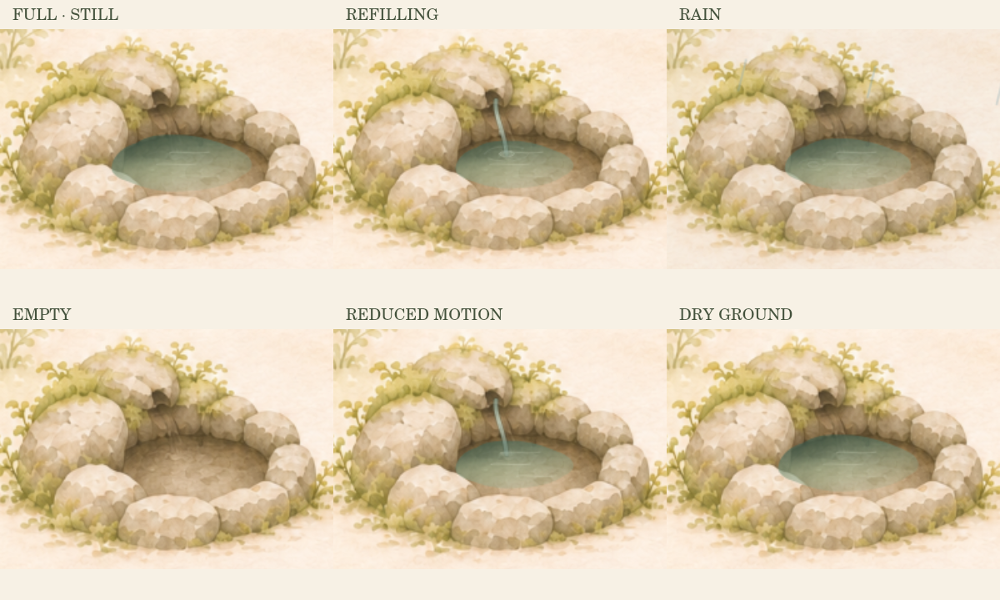
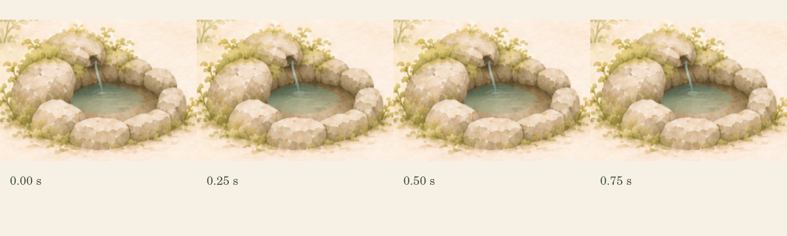
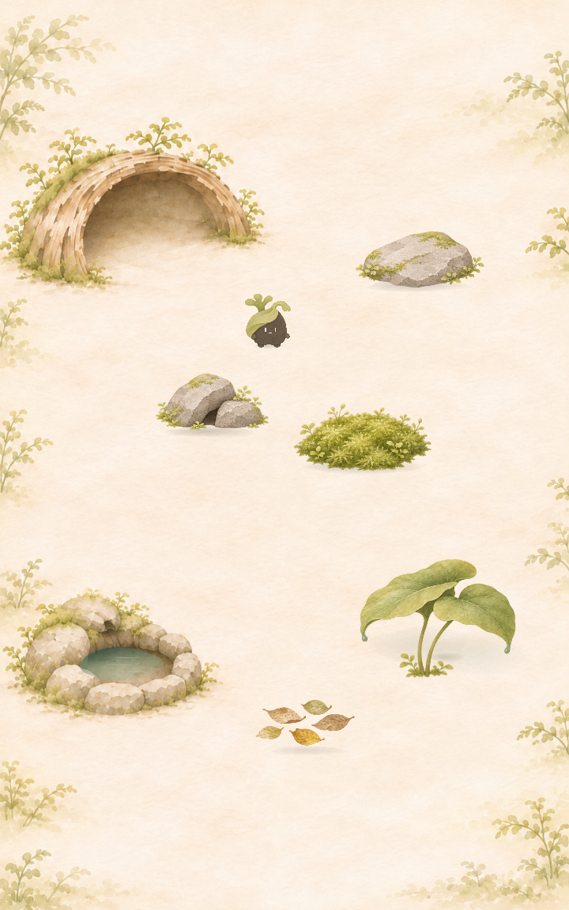
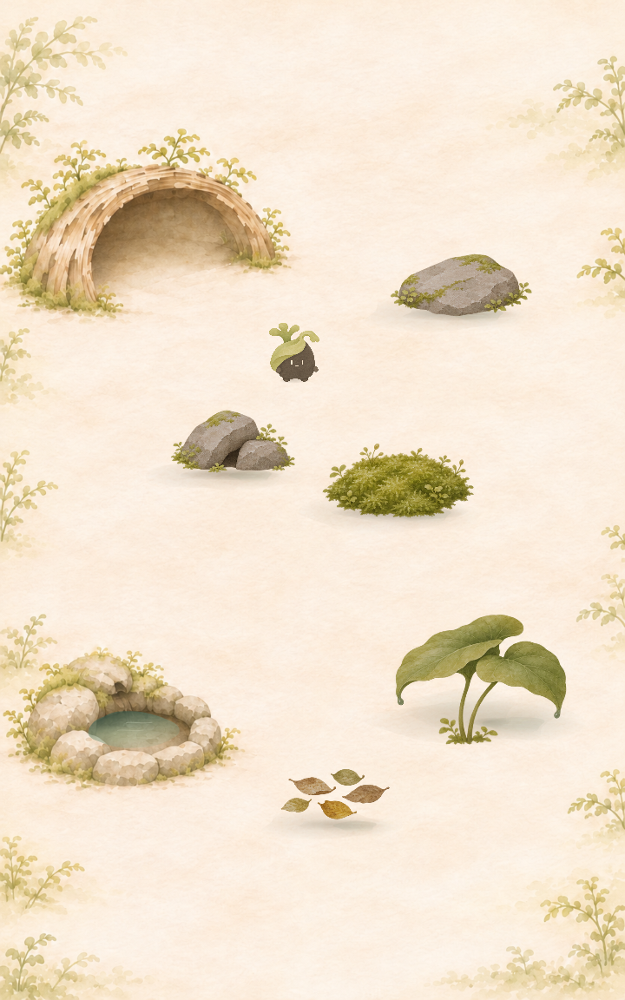

# 수면·유입·접지·젖음 디자인 보완 · 0.4.3

적용 기준: 통합 명세 v2.8 개정 1 REV28-04~06, VFX-01~08. 사용자 보고: 오브젝트 밑 타원 뭉침과 샘물의 단색 타원이 수채화 장면에서 인위적으로 보임.

| 요소 | 시각 규칙 | 입력·중단 조건 |
|---|---|---|
| 접지 | 실제 물체 하단에 얇은 따뜻한 회갈색 농담, 경계 소멸 | 월드 좌표에 고정, 카메라와 함께 변환 |
| 잎 그늘 | 두 잎의 비대칭 희미한 그림자 + 줄기 접지 | 기존 기능 차광과 독립, 자원값 변경 없음 |
| 젖음 | 불규칙한 흙빛 얼룩 두 층, 가장자리 투명, 지형별 윤곽 고정 | M과 film, 물이 마르면서 농담 감소, 렌더 난수 금지 |
| 지형 고임 | 흙 얼룩보다 작은 불규칙 저채도 수면, 잘린 짧은 반사 | W>0.01에만 표시, 비 파문은 마스크 내부 |
| 샘터 수면 | 돌 안쪽을 따라 부드러운 곡선, 깊은 뒤쪽→얕은 앞쪽, 배경 바닥 질감 투과 | 잔량>0. 잔량이 줄면 수면이 내려가며 줄어듦. 0에서 제거 |
| 샘터 유입 | 뒤쪽 돌 틈에서 가는 물줄기, 작은 접촉 파문, 흐름 속 하이라이트 | game·started·온라인 생활·실제 inflow>0. 가득 차 공급 0이면 끔 |
| 정적 대체 | 정적 반사광과 물줄기 위치 표식 | reducedMotion: 시간에 따른 광택 이동·파문 생략 |

유입 물량·잔량·음수 정산은 엔진만 소유한다. 이번 변경은 보충량(최대 10/분), 최대 잔량 60을 변경하지 않는다. 최초 가득 찬 샘터에서는 물줄기가 나오지 않으며 소비 후 보충 중 보인다. 잔량만으로 유입 소리를 켜지 않는다.

## 실제 런타임 프레임

위 이미지는 최종 surfaces.js/scene.js를 Canvas로 실행한 렌더 결과다. 실기기 캡처가 아니다. 기존 수채화 래스터 자산을 보존하며 오버레이만 코드로 변경했다. 시간 변화는 시각 효과에 한정하며 캐릭터 위치·충돌·난수·자원을 바꾸지 않는다.
